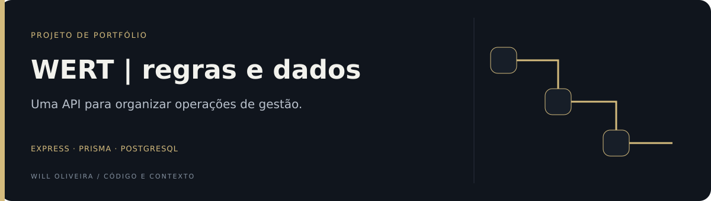

<p align="center">
  
</p>

# WERT · API de gestão

API REST para usuários, empresas, produtos e movimentações de estoque.

**Node.js · Express · TypeScript · Prisma · PostgreSQL**

[Frontend](https://github.com/Will-Ifes/wert-frontend) · [Código](src) · [Execução](#executar)

## Explore o diferencial

| Ponto de entrada | O que observar |
| --- | --- |
| [Modelagem de negócio](prisma/schema.prisma) | O schema explicita relações entre organização, pessoas, catálogo e estoque. |
| [Regras de estoque](src/domain/stockManagement) | O domínio de movimentações permite seguir as operações além da rota HTTP. |

## O projeto

| Grupo | Entidades e recursos |
| --- | --- |
| Organização | Empresas, setores e cargos |
| Pessoas | Usuários, colaboradores e endereços |
| Catálogo | Produtos, fabricantes e fornecedores |
| Estoque | Movimentações e relações com produtos e usuários |
| Acesso | Autenticação, permissões, grupos e códigos de ativação |

O schema relaciona várias entidades a um `Tenant`. A presença dessa relação não garante, por si só, isolamento de dados: filtros e autorização de cada rota precisam ser avaliados.

<details>
<summary><strong>Arquitetura e caminhos de leitura</strong></summary>

### Arquitetura

| Camada | Responsabilidade |
| --- | --- |
| [src/application/routes](src/application/routes) | Registro dos endpoints |
| [src/domain](src/domain) | Controllers, services, repositories e modelos por domínio |
| [src/infrastructure](src/infrastructure) | Prisma, hash, criptografia e logging |
| [prisma](prisma) | Schema e migrações |
| [tests](tests) | Testes de rotas com Jest e Supertest |

As rotas encaminham chamadas aos módulos de domínio. Repositories concentram o acesso aos dados; services organizam operações. Essa separação facilita a leitura das regras sem misturar todos os detalhes no servidor HTTP.

### Por dentro do código

- [Modelo relacional](prisma/schema.prisma).
- [Autenticação com hash e JWT](src/domain/authLogin/AuthLoginService.ts).
- [Middleware de token](src/middleware/auth.ts).
- [Domínio de movimentações](src/domain/stockManagement).
- [Teste de API de endereços](tests/address.test.ts).

</details>

<a id="executar"></a>

<details>
<summary><strong>Executar e validar</strong></summary>

Requer Node.js, pnpm, PostgreSQL e certificados locais. Configure `DATABASE_URL` e `JWT_SECRET` no ambiente do processo. Confira o carregamento das variáveis: criar um arquivo `.env` não substitui garantir que o processo recebeu os valores.

```bash
git clone https://github.com/Will-Ifes/wert-backend.git
cd wert-backend
pnpm install
pnpm run prisma:generate
pnpm run prisma:migrate
```

O entrypoint [Server.ts](src/application/server/Server.ts) lê `privateCertificate.key` e `certificate.crt` na raiz e inicia HTTPS na porta 3333, ou no valor de `PORT`. Esses arquivos não acompanham a cópia pública. Gere certificados próprios e confiáveis no ambiente de desenvolvimento; mantenha a chave privada fora do Git.

Com certificados e variáveis configurados:

```bash
pnpm dev
```

Revise também as origens permitidas em `src/application/server/App.ts` para o seu frontend local. Não execute `prisma:init` sobre esta base: o schema já existe.

### Comandos

| Comando | Finalidade |
| --- | --- |
| `pnpm build` | Compilar TypeScript |
| `pnpm start` | Executar a build |
| `pnpm test` | Testes Jest |
| `pnpm run prisma:generate` | Gerar cliente Prisma |
| `pnpm run prisma:migrate` | Aplicar migrações em desenvolvimento |
| `pnpm lint` | Verificar configuração de lint |

Os testes de integração criam e removem registros. Use um banco exclusivo de testes e confirme o `DATABASE_URL` efetivo antes de executar. A existência dos testes não é uma declaração de cobertura completa ou aprovação atual.

</details>

<details>
<summary><strong>Contexto, evolução e uso</strong></summary>

Trabalho desenvolvido por Will Oliveira no projeto WERT, com colaboração registrada no projeto original. Esta edição de portfólio tem histórico novo e preserva o código revisado, sem os dumps de banco do desenvolvimento original.

### Evolução

- Simplificar a inicialização local e centralizar configuração.
- Revisar isolamento entre empresas e autorização por operação.
- Consolidar contratos de erro e validação.
- Ampliar testes de autenticação, permissões e estoque.

### Procedência

A edição foi preparada para portfólio, sem importar dados reais. O manifesto declara licença ISC; preserve a atribuição e confira os termos antes de redistribuir.

Mantido por **Will Oliveira** · [Perfil](https://github.com/Will-Ifes) · [LinkedIn](https://www.linkedin.com/in/wildemberg-de-jesus-oliveira/)

</details>

---

**Will Oliveira** · [LinkedIn](https://www.linkedin.com/in/wildemberg-de-jesus-oliveira/) · [GitHub](https://github.com/Will-Ifes)
